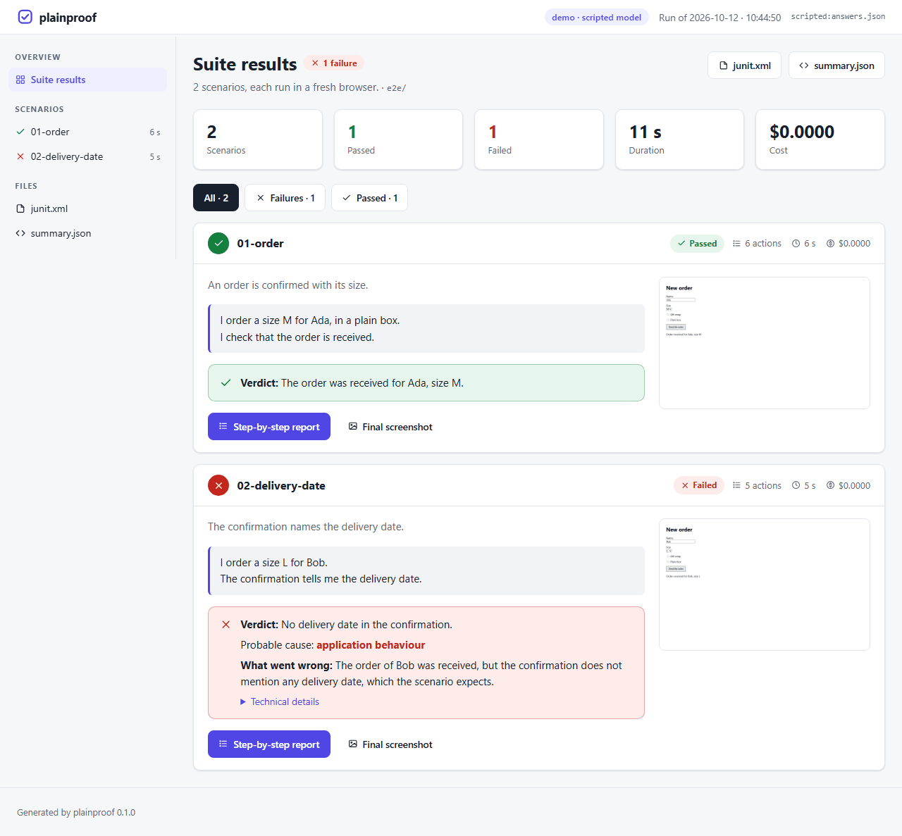
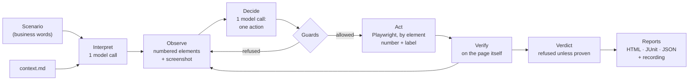

# plainproof

**Browser tests written in plain language, run by the LLM of your choice, with every verdict proven on the page.**

[](https://github.com/fjoalland/plainproof/actions/workflows/ci.yml)
[](pyproject.toml)
[](LICENSE)

Whoever knows the application writes what they do and what they expect to see, in their own words.
plainproof opens a browser, lets a vision model read the page and act on it, **checks every expected
result against the real page** (never against what the model believes it saw), and writes a report:
a verdict, a plain-language explanation of any failure, a screenshot of every action and a video.

```text
# e2e/checkout/02-promo-code.txt
I add the blue mug to my basket and open the basket.
I enter the code "SPRING10": the total goes down by 10%.
An expired code like "WINTER23" is refused with a message saying it expired.
```

```text
[2/5] checkout-02-promo-code
Understood as 6 steps:
  01 Click "Blue mug", then "Add to basket"
  02 Click "Basket"
  03 Type "SPRING10" into "Promo code" and click "Apply"
  04 Verify that the total is 10% lower ✓
  05 Type "WINTER23" into "Promo code" and click "Apply"
  06 Verify that a message says the code "WINTER23" expired ✓
...
FAILED  checkout-02-promo-code (41s)
  explanation: The spring code was applied correctly, but the expired code was accepted without any message.
  probable cause: application behaviour
```



## Why plainproof

- **Scenarios in business words.** No selectors, no code, no Gherkin: a `.txt` file per test, written by
  whoever knows the product. A one-off `context.md` written by the team explains the login, the menus
  and the vocabulary, so scenarios stay short. See [Writing scenarios](docs/writing-scenarios.md).
- **Any LLM.** Anthropic Claude, OpenAI, Google Gemini, Mistral, local models through Ollama or LM Studio,
  OpenRouter, or any OpenAI-compatible server — and your own provider through a plugin.
  See [Model providers](docs/llm-providers.md).
- **Verdicts you can trust.** A model may say "success"; plainproof decides. A success is refused when a
  check failed, when a verification was skipped, or when the scenario was not carried out to the end.
  A check described in words is judged by a separate call that must quote the page, and the quote must
  really be there. Every guard answers a false success seen on a real application.
  See [How verdicts stay honest](docs/reliability.md).
- **Record once, replay for free.** A scenario that passes leaves a recording; `plainproof replay` plays
  it back without any model (no key, no cost), and a plain Playwright test is generated next to it.
  See [Record and replay](docs/record-and-replay.md).
- **Reports for people and for CI.** Static HTML pages (step-by-step screenshots, video, explanation of
  failures), `junit.xml` for your CI's test tab, `summary.json` for scripts, and a history page that
  compares campaigns over time. See [Reports](docs/reports.md) and [Campaigns](docs/campaigns.md).
- **Secrets stay secret.** `${APP_PASSWORD}` is typed into the page for real but never shown to the model,
  nor written in a report or a log.

## Quick start

```bash
pip install plainproof             # before the first PyPI release: pip install git+https://github.com/fjoalland/plainproof
playwright install chromium        # or use an installed Chrome / Edge: --browser chrome
export ANTHROPIC_API_KEY=...        # or OPENAI_API_KEY, GEMINI_API_KEY, MISTRAL_API_KEY... (see below)
```

Try it on a public demo application, with the examples of this repository:

```bash
plainproof run examples/the-internet --model anthropic:claude-sonnet-5-5
```

Then on your own application:

```bash
plainproof init e2e                 # a context.md to fill in, an example scenario, a plainproof.toml
plainproof run e2e --url https://staging.example.com
```

Open `runs/<date>/index.html`. The exit code is `0` when every scenario passes, `1` when one fails,
`2` for a setup problem. More in [Getting started](docs/getting-started.md).

## Supported models

`--model provider:model`, `PLAINPROOF_MODEL`, or `model = "..."` in `plainproof.toml`. A provider alone
selects its default model; with a single API key set and no model given, that provider is used.

| Provider | Example | API key | Default model |
|---|---|---|---|
| Anthropic | `anthropic:claude-sonnet-5-5` | `ANTHROPIC_API_KEY` | `claude-sonnet-5-5` |
| OpenAI | `openai:gpt-6.1-sol` | `OPENAI_API_KEY` | `gpt-6.1-sol` |
| Google Gemini | `gemini:gemini-3.8-flash` | `GEMINI_API_KEY` or `GOOGLE_API_KEY` | `gemini-3.8-flash` |
| Mistral | `mistral:mistral-medium-latest` | `MISTRAL_API_KEY` | `mistral-medium-latest` |
| Ollama (local) | `ollama:qwen2.5vl:7b` | — | — |
| LM Studio (local) | `lmstudio:<model>` | — | — |
| OpenRouter | `openrouter:<vendor/model>` | `OPENROUTER_API_KEY` | — |
| Any OpenAI-compatible server | `openai-compatible:<model> --base-url http://host:8000/v1` | `PLAINPROOF_API_KEY` (optional) | — |

`plainproof providers` shows which keys are set. A vision model works best (it gets an annotated
screenshot at every step); text-only models run with `--no-vision`. The cost of every run is shown in
the reports, from the providers' public prices; override or add prices in `plainproof.toml`.

## How it works



1. **Interpret.** One call turns the scenario into precise steps, each an action or a verification, tied
   to the line it comes from. It adds the login when the context describes it and translates the
   business vocabulary into screen labels. This is shown at the top of each report: the first thing to
   read when a test fails.
2. **Observe.** Every interactive element of the *whole* page is numbered, and a screenshot is annotated
   with those numbers.
3. **Decide.** The model gets the screenshot, the element list, the steps, its progress, its notes and a
   one-line history, and answers with one action: `click`, `type`, `select`, `check`, `finish`...
4. **Act.** The action runs on the numbered element (never on pixel coordinates), after its label has
   been checked against the element the model named.
5. **Verify.** A check looks for a text or a URL on the page, or is judged on meaning by a separate call
   whose quote must be on the page.
6. **Conclude.** A success is refused unless every verification of the scenario was made and passed.
   After a failure, one call explains what went wrong and its probable cause.

Why Playwright drives the browser rather than an agent extension (Claude in Chrome, for example):
plainproof needs a headless, scriptable browser that runs in CI, with every LLM, and deterministic
control between the model and the page for its guards. See [Architecture](docs/architecture.md).

## Documentation

| | |
|---|---|
| [Getting started](docs/getting-started.md) | install, first run, troubleshooting (proxies, browsers) |
| [Writing scenarios](docs/writing-scenarios.md) | for the people who know the product |
| [Project context](docs/project-context.md) | the one file the technical team writes |
| [Model providers](docs/llm-providers.md) | every provider, local models, custom plugins, costs |
| [Configuration](docs/configuration.md) | command line, environment variables, `plainproof.toml` |
| [Reports](docs/reports.md) | what is written, how to read a failure, publishing |
| [Record and replay](docs/record-and-replay.md) | replay without a model, generated Playwright tests |
| [Campaigns](docs/campaigns.md) | follow an application over versions |
| [Continuous integration](docs/continuous-integration.md) | GitHub Actions, GitLab CI, any CI |
| [How verdicts stay honest](docs/reliability.md) | the guards, and the real failures behind them |
| [Architecture](docs/architecture.md) | the code, its extension points, design decisions |

## Limitations

- **CAPTCHAs and bot walls** are never bypassed: the test fails and says so.
- **Iframes and canvases**: their elements are not numbered (the text of visible iframes is read by checks).
- **At most 150 numbered elements** per page (those on screen first). While a modal dialog is open, only
  its elements are listed.
- **Some custom dropdowns** resist `select`; the context can say "click the field, then the option".
- **Not fully deterministic**: models are sampled at a low temperature. Run a new suite a few times
  before calling it stable, then replay it without a model for regression runs.
- **Screenshots and videos show what the test account sees**: publish reports with restricted access and
  use test data. A secret typed into a plain text field (not a password field) is visible on screenshots.

## Related projects

AI-driven browser testing is a lively field; pick the tool that fits your need.

- [Midscene.js](https://github.com/web-infra-dev/midscene) — a vision-based GUI agent and test framework
  (TypeScript) for web, mobile and desktop apps. Prefer it for native or canvas-heavy interfaces and for
  visual assertions (colours, layout).
- [Shortest](https://github.com/antiwork/shortest) and [Magnitude](https://github.com/magnitudedev/browser-agent) —
  natural-language web tests in TypeScript.
- [Playwright test agents](https://playwright.dev/docs/test-agents) — an LLM plans, writes and repairs
  classic Playwright tests.
- [Stagehand](https://github.com/browserbase/stagehand), [Browser Use](https://github.com/browser-use/browser-use),
  [Skyvern](https://github.com/Skyvern-AI/skyvern) — building blocks to automate browsers with AI.

plainproof's focus: acceptance tests written in plain language by the people who know the product, in
Python, with any LLM, and verdicts that cannot pass without proof found on the page.

## Contributing

Contributions are welcome: bug reports with a report attached, new providers, new languages for the
reports, guards for a false verdict you met. See [CONTRIBUTING.md](CONTRIBUTING.md). The project is
developed test-first: every behaviour has its test, including each guard's real-world case.

## License

[MIT](LICENSE)
