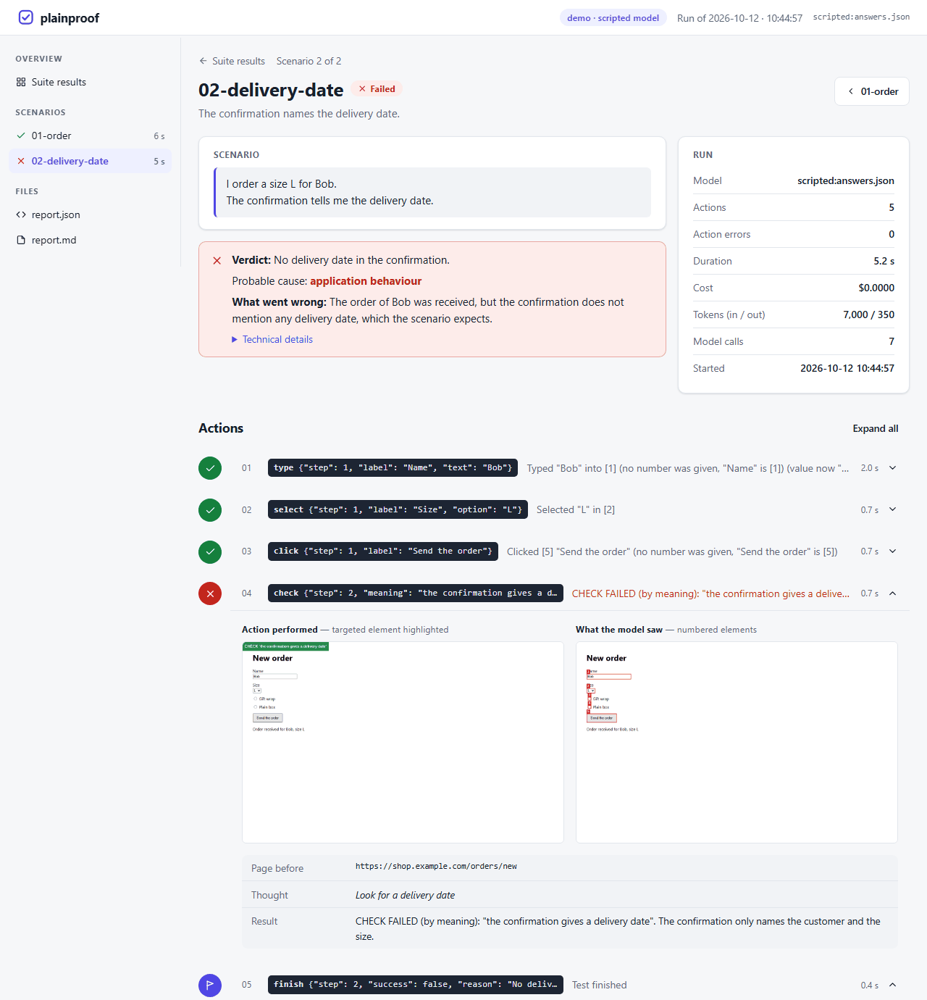

# Reports

Every run writes a folder (`--out`, default `runs/<date-time>`):

```text
runs/20261012-093000/
├── index.html           the suite: statistics, filters, one card per scenario
├── junit.xml            one test case per scenario, for your CI's test tab
├── summary.json         the same, for scripts
└── orders-02-refund/
    ├── report.html      the step-by-step report
    ├── report.json      everything: the plan, every action with its evidence, the usage
    ├── report.md        a Markdown version
    ├── video.webm       the run (unless --no-video)
    ├── step_01.png      what the model saw (numbered elements)
    ├── step_01_action.png   the action performed (targeted element highlighted)
    ├── ...
    └── final.png        the last page
```

The pages are static HTML without any external resource (no font, no script, no stylesheet from the
web): they open from disk, from a CI artifact or from any static host, offline included, in light or
dark mode. Screenshots and videos are referenced by relative path: publish the folder as a whole.

## The step-by-step report



From top to bottom:

1. **The scenario**, as its author wrote it, and its description.
2. **How plainproof understood the scenario**: the precise steps, each with the line it comes from (or
   "added from the project context" for a login), verifications tagged. The first thing to read when a
   test fails: a misunderstood sentence shows here.
3. **The verdict**, and on failure:
   - **What went wrong**: two to four sentences for someone who did not watch the run;
   - **Probable cause**: scenario wording, application behaviour (maybe a real defect), test agent
     limitation, environment or data, or undetermined;
   - **Technical details**, folded: steps, exact messages, last page, a concrete suggestion.
4. **The run**: model, actions, errors, duration, cost, tokens, model calls.
5. **The video** of the run, with speed controls.
6. **The actions**, folded except errors, failed checks and the verdict: the targeted element highlighted
   on its screenshot, what the model saw and thought, the result. A check judged on meaning shows the
   passage of the page that proves it (`The page shows: "..."`), or what the judge found instead.
7. **The final state** of the page.

## The suite overview and CI outputs

`index.html` gives the counts (scenarios, passed, failed, duration, cost), filters (all, failures,
passed), and a card per scenario with its text, verdict, explanation and video.

`junit.xml` reports each scenario as a test case: a failure's message is the model's explanation (what
CI shows first), followed by the technical details and the action trace; a crash (browser that could
not start, missing recording) is an error; a canary scenario (`# expect: failure`) that failed as
expected is a success. The cost of each scenario is in its `system-out`.

`summary.json` holds the same data for scripts: status (`passed`, `failed`, `expected-failure`,
`unexpected-pass`, `error`), reason, explanation, diagnosis, duration, actions, usage.

## Updating a report

```bash
plainproof run e2e/orders/02-refund.txt --out runs/20261012-093000 --update
```

reruns the given scenarios inside an existing report: their folders are replaced, the others are kept,
and the overview, `summary.json` and `junit.xml` are recomputed. A scenario run on its own gets back the
name it has in the report.

## Language

Reports, console, JUnit and the model's explanations follow `--language` (`en` or `fr`), derived from
`--locale` when not given: `--locale fr-FR` gives French reports. Action results (`Clicked [3] "Save"`,
`CHECK OK: ...`) stay in English: they are what the model reads in its history. Adding a language is a
JSON file in `src/plainproof/i18n/` (see [CONTRIBUTING](../CONTRIBUTING.md)).

## Publishing reports

- **They contain data of the application**: every screenshot and the video show what the test account
  saw (names, identifiers, amounts). Publish them with restricted access (for instance GitHub Pages of a
  private repository, or GitLab Pages restricted to project members) and test with test data.
- **They contain nothing of the machine that produced them**: no absolute path (paths are relative to
  the working folder, screenshots referenced by name), and no secret: values of secret variables are
  replaced by their `${NAME}` everywhere, and password fields are never read.
